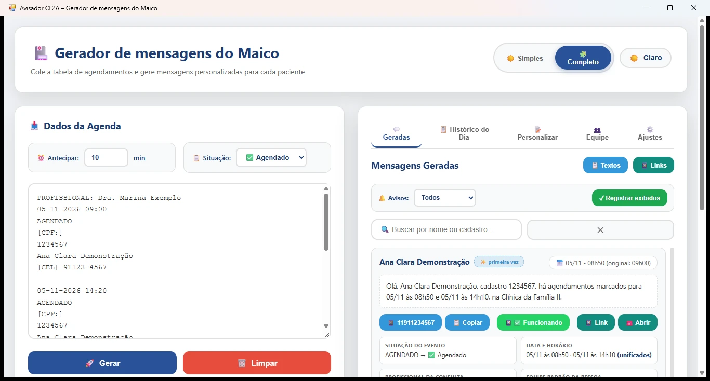

# Avisador CF2A

**Gerador de mensagens do Maico** — app de desktop Windows que transforma a tabela de agendamentos da clínica em mensagens de WhatsApp de lembrete de consulta, prontas para enviar a cada paciente.



- **Landing page:** https://wavizo-bot.github.io/Avisador-CF2A/
- **Microsoft Store:** https://apps.microsoft.com/detail/9PFP3R8HZJ7H
- **Versão atual:** v1.4.0 (pacote 1.4.0.0)

## O que faz

Você cola a tabela de agendamentos exportada do sistema da clínica (texto puro), escolhe a situação (Agendado, Cancelado ou Faltou) e clica em Gerar. O app monta uma mensagem por paciente, com o horário já antecipado pela quantidade configurada (só no Agendado — cancelados e faltas mantêm o horário original) e o link pronto para abrir no WhatsApp.

### Recursos principais

- **Modo Simples ou Completo** — o Simples mostra só o essencial (como as versões anteriores); o Completo libera todos os dados abaixo;
- Geração por situação, com modelos de mensagem personalizáveis (aba Personalizar) e prévia ao vivo;
- Mensagem de **Cancelado** avisando que nova data será enviada; mensagem de **Faltou** perguntando o motivo, sem remarcar;
- Cartão por paciente com telefone, botão de copiar texto, link e abertura direta no WhatsApp;
- **Memória de avisos**: cada cartão marca ✨ primeira vez ou 🔔 já avisado, com data e canal (WhatsApp ou SMS) — copiar, abrir ou enviar SMS registra o aviso e evita reaviso;
- **Equipe responsável**: importação local dos arquivos de equipe do BI (equipes + agendas), equipe padrão por pessoa (médica, enfermeira, assistente) e lista de profissionais com telefone para contatar quando o número do paciente falha;
- **Fila de agendas (lotes)**: acumule várias agendas antes de gerar — agendamentos da mesma pessoa são unificados numa única mensagem;
- **Envio de SMS** pelo aplicativo OpenSMS no seu próprio celular, na rede local (endereço e chave configurados na aba Ajustes);
- Marcação ✅ Funcionou / ❌ Não funcionou por paciente, persistida entre sessões;
- Histórico do dia/sessão em tabela, com busca, ordenação da cópia, exportação CSV e limpeza seletiva;
- Temas claro e escuro, DDD padrão e horário de abertura configuráveis;
- Onboarding em 3 passos com dados de demonstração na primeira execução;
- Versão dinâmica no rodapé, lida do manifesto do pacote instalado.

## Privacidade e armazenamento

**100% offline.** Não há login, conta, nuvem, analytics, cookies nem telemetria — e nenhuma integração com Google Drive ou OAuth. Todos os dados (agenda colada, base de equipe importada, memória de avisos, histórico, configurações e marcações) ficam apenas no perfil local do usuário (`%LOCALAPPDATA%\wavizo\AvisadorCF2A`) e são apagados pelos botões internos do app ou na desinstalação. O envio de SMS, se você o usar, sai do chip do seu próprio celular via servidor OpenSMS na sua rede local — nada trafega por servidores do desenvolvedor.

Documentos legais (publicados também na landing):

- [Política de Privacidade](https://wavizo-bot.github.io/Avisador-CF2A/politica-de-privacidade.html)
- [Termos de Serviço](https://wavizo-bot.github.io/Avisador-CF2A/termos-de-servico.html)
- [Aviso Legal](https://wavizo-bot.github.io/Avisador-CF2A/aviso-legal.html)

## Requisitos

- Windows 10 ou Windows 11 (x64 ou x86);
- Runtime WebView2 (já presente no Windows 11; a Store instala quando necessário);
- Nenhuma outra dependência — o app não precisa de internet para funcionar.

## Como executar em desenvolvimento

O app é um host WinForms (.NET Framework 4.8, C# 5) que hospeda toda a interface em HTML/JS. A fonte da UI é `Package/html/FullAutoMensagensWhatsapp_v7.html`.

1. Abrir a solução/compilar `src/Program.cs` com o `csc` do .NET Framework 4.8 (referências `Microsoft.Web.WebView2.Core`/`.WinForms` em `src/packages/`);
2. Copiar o HTML para a pasta `html` ao lado do executável — o host serve o conteúdo pela origem virtual `https://avisador.local` (`SetVirtualHostNameToFolderMapping`);
3. Executar o exe. Para agilidade, use o build de staging gerado pelo script (`src/out/`).

## Como gerar o pacote (MSIX)

```powershell
powershell -ExecutionPolicy Bypass -File src\build.ps1 -Arch all -Sign
```

O script faz staging, compila, gera `.msix` (x64/x86) e `.msixbundle`, assina com o certificado de teste e carimba a versão no HTML (`__VERSAO_BUILD__`). Saída em `build/`; a entrega vai para a pasta `entregas/windows/` (fora do git — binários não são versionados, ver `.gitignore`).

Validação de qualidade (WACK, requer elevação):

```powershell
powershell -ExecutionPolicy Bypass -File src\elevated-validate.ps1 -CertFile build\test-cert.cer -PackagePath build\AvisadorCF2A_<versao>.msixbundle -ReportPath build\wack-report.xml -LogPath build\wack-log.txt
```

Último resultado WACK: **OVERALL PASS, 24/24 testes** no bundle 1.3.0.0.

Teste automatizado da interface (suíte embutida, executada dentro do pacote instalado): **73 PASS, 0 FAIL** no build 1.4.0.0 — inclui toggle de modo, memória de avisos, unificação de lotes, importação da base do BI e a ponte de SMS de ponta a ponta.

## Estrutura de pastas

```
.
├── Package/html/          Interface completa (SPA + modal de termos) — fonte da UI
├── src/
│   ├── Program.cs         Host WinForms + WebView2 (origem virtual avisador.local)
│   ├── build.ps1          Build/empacotamento/assinatura do MSIX
│   ├── make-assets.ps1    Gera ícones/tiles/splash a partir do logo
│   ├── make-store-assets.ps1  Logo 512 + capturas automatizadas da Store
│   ├── elevated-validate.ps1  WACK elevado
│   ├── packages/          WebView2 SDK (NuGet)
│   └── out/               Staging de build (gerado, não versionado)
├── docs/                  GitHub Pages: landing, legais, capturas WebP, OG, robots, sitemap
├── _antigos/              Manifestos legados de referência
├── PRIVACIDADE.md         Política em Markdown (versão antiga; a canônica é docs/)
├── logo.png / smalllogo.png
└── .gitignore             Segredos, binários e dados de execução fora do git
```

## Sobre o projeto

Ferramenta independente de apoio à decisão da equipe de saúde — **não é** sistema oficial, prontuário eletrônico, dispositivo médico nem substituto de profissional habilitado. A versão de demonstração vale 1 mês; licenciamento pelo contato abaixo.

Contato: **mmr05@hotmail.com** · WhatsApp **11 978831938**

---

### English summary

**Avisador CF2A** is a free Windows 10/11 desktop tool (WinForms + WebView2 host, HTML/JS interface) that turns a clinic's appointment schedule into ready-to-send reminder messages for each patients. Paste the schedule, pick the status (booked, cancelled or missed) and the app prepares one message per patient — with the appointment time shifted forward when needed — plus a direct WhatsApp link, a daily history with search and CSV export, customizable message templates, a record of who was already reminded (WhatsApp or SMS), the patient's care team for fallback contact, multi-schedule batching with per-person message merging, and optional SMS through a local OpenSMS server on your own phone. It runs **fully offline**: no account, no cloud, no tracking; data stays in the local user profile. It is an independent decision-support helper, not an official health system, medical record or medical device. Build with `src/build.ps1`; store packages live outside the repository. Contact: mmr05@hotmail.com.
